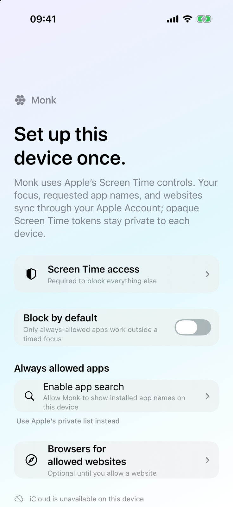
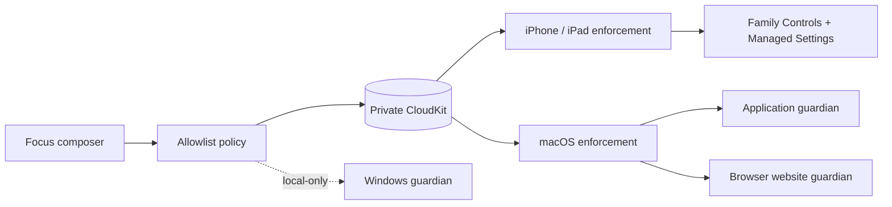

<div align="center">

# Monk

### Decide what matters. Make everything else wait.

An allowlist-first focus system for iPhone, iPad, Mac, and Windows.

[](https://www.swift.org/)
[](#platforms)
[](Windows/README.md)
[](LICENSE)

</div>

Monk reverses the usual relationship with technology. You do not start with every app and website available, then try to resist them. You name the task, choose its duration, and explicitly allow only the tools it needs. Monk blocks everything else until the commitment ends.

<p align="center">
  
  &nbsp;&nbsp;&nbsp;
  
</p>

## The interaction

Every focus starts with four choices:

1. **What are you doing?** — a plain-language intention.
2. **For how long?** — a commitment measured in hours and minutes.
3. **Which apps are allowed?** — every other app is unavailable.
4. **Which websites are allowed?** — browser access follows the same allowlist.

An active commitment cannot be ended early. When its timer reaches zero, Monk asks whether to extend it or finish. You can also enable **Block by default**, which keeps apps unavailable between sessions except for a small always-allowed list.

## Highlights

- **One commitment across Apple devices.** Active sessions sync through the user's private CloudKit database.
- **Private app matching.** Human-readable app identities sync; opaque Screen Time tokens remain on the device that created them.
- **Real platform enforcement.** iPhone and iPad use Apple's Family Controls stack. Mac uses local application and browser guardians.
- **Fast desktop command panel.** Press `Option` + `Space` on Mac (`Alt` + `Space` on Windows).
- **Siri temporary access.** Ask Monk to allow one or more apps for a short period on supported iPhone and iPad versions.
- **No service to trust.** There is no Monk account, analytics SDK, advertising, subscription system, or developer-operated backend.

## Platforms

| Platform | Status | Enforcement | Sync |
| --- | --- | --- | --- |
| iPhone / iPad | Active | Family Controls, Managed Settings, Device Activity | Private CloudKit |
| macOS | Active | App guardian, browser guardian, Apple Events | Private CloudKit |
| Windows 10 / 11 | Experimental | Process guardian, Chromium extension, native messaging | Local only |

The full Mac build is designed for direct distribution rather than the Mac App Store because its enforcement needs automation access and control of other applications. The mobile build is structured for App Store distribution, subject to Apple granting the Family Controls distribution capability.

## Run it locally

### Apple platforms

You need a Mac with Xcode and an Apple Developer account.

```sh
git clone https://github.com/gabebere/monk.git
cd monk
cp Configurations/Local.xcconfig.example Configurations/Local.xcconfig
open Monk.xcodeproj
```

Replace the values in `Configurations/Local.xcconfig` with identifiers owned by your developer account, create the matching App Group and iCloud container, then select your team in Xcode. The complete walkthrough is in **[docs/SETUP.md](docs/SETUP.md)**.

Useful commands:

```sh
# Build iPhone and iPad
xcodebuild -project Monk.xcodeproj -scheme Monk \
  -configuration Debug -destination 'generic/platform=iOS Simulator' build

# Build and launch MonkOS on Mac
./script/build_and_run.sh

# Run macOS policy tests
xcodebuild test -project Monk.xcodeproj -scheme MonkMac \
  -destination 'platform=macOS'
```

### Windows

On Windows 10/11 with the .NET 8 SDK:

```powershell
./Windows/scripts/build.ps1
```

See **[Windows/README.md](Windows/README.md)** for browser-extension setup and the current hardening boundary.

## How it fits together



The system keeps shared intent separate from platform-private enforcement data. A synced session contains its intention, dates, allowed domains, and portable app identities. Each device resolves those identities to its own installed apps and applies its local policy. Read the deeper design in **[docs/ARCHITECTURE.md](docs/ARCHITECTURE.md)**.

## Repository map

```text
Monk/                       iPhone and iPad SwiftUI app
MonkMac/                    macOS menu-bar app (MonkOS)
HardBlockShieldExtension/   iOS/iPadOS shield appearance
MonkDeviceActivityMonitor/  mobile session-expiry extension
Shared/                     code compiled by Apple app targets
MonkMacTests/               policy, parser, and service tests
Configurations/             fork-friendly Apple build settings
Windows/                    experimental Windows implementation
docs/                       setup and architecture guides
script/                     local build and launch tools
```

## Privacy and security

Monk's focus data stays on the user's devices and in their private iCloud database. It does not send usage data to the repository owner. App selections created through Screen Time are opaque Apple tokens and stay local to each Apple platform.

Desktop blocking is a strong behavioral boundary, not a substitute for operating-system administration. A device owner with administrator access can ultimately stop or remove desktop software. Please report security issues privately as described in **[SECURITY.md](SECURITY.md)**.

## Contributing

Monk is intentionally small and opinionated. Contributions that strengthen the allowlist model, reliability, accessibility, or platform parity are welcome. Please read **[CONTRIBUTING.md](CONTRIBUTING.md)** before opening a pull request.

## License

Released under the [MIT License](LICENSE).
