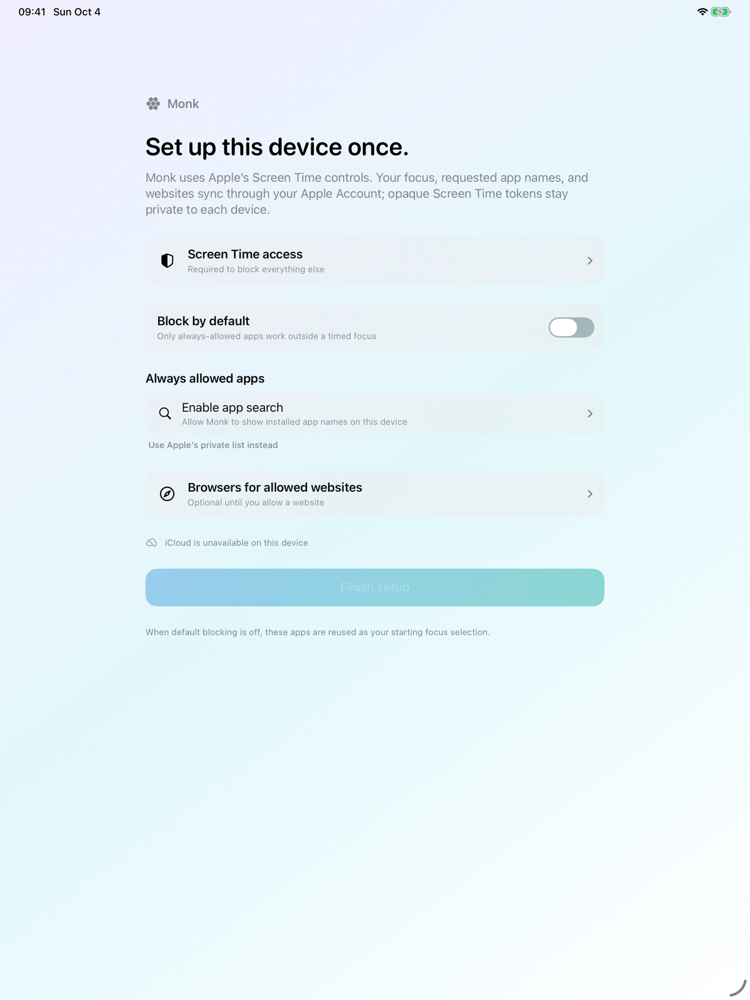

<div align="center">

# Monk

### Decide what matters. Make everything else wait.

An allowlist focus system for iPhone, iPad, and Mac.

[](docs/PRODUCT_1.0.md)
[](release/1.0.0.json)
[](LICENSE)

</div>

Choose an intention, a duration, and the apps/websites it needs. Monk blocks everything else until the commitment expires and you choose to finish or extend. Optional default blocking keeps only explicitly allowed apps available between sessions.

**Monk 1.0 is an unreleased candidate.** The source, release tooling, and readiness manifest are versioned together; Apple approvals, Production sync, signed artifacts, and fresh-device acceptance remain explicit release gates.

<p align="center">
  
  &nbsp;&nbsp;&nbsp;
  
</p>

## Apple product structure

| Product surface | Target | Installation route | Documentation |
| --- | --- | --- | --- |
| Monk for iPhone 1.0 | `Monk` | Universal TestFlight/App Store app | [iPhone contract](docs/platforms/IPHONE.md) |
| Monk for iPad 1.0 | `Monk` | Same universal app, version, and mobile build | [iPad contract](docs/platforms/IPAD.md) |
| Monk for Mac 1.0 (MonkOS) | `MonkMac` | Developer ID signed, notarized direct download | [Mac contract](docs/platforms/MAC.md) |

Phone/tablet use Family Controls, Managed Settings, and Device Activity. Mac uses native application/browser guardians and Apple Events. Both coordinate portable focus intent through the same user's private CloudKit database. Screen Time tokens and local app paths stay on their originating device. There is no Monk account, analytics SDK, subscription system, or developer-operated backend.

Installed-app name discovery on mobile is optional and subject to Apple's OS, authorization, and EU customer restrictions. Apple's native local app picker remains available; unresolved cross-device app requests can be mapped to local equivalents. Cross-device updates depend on network and OS execution opportunities and are not an instant remote-control guarantee.

## Build and run

Use a Mac with Xcode 26.4+ SDKs. Supported runtimes start at iOS/iPadOS 18.5 and macOS 14. Follow [setup](docs/SETUP.md) to provision identifiers, capabilities, the App Group, and iCloud container.

```sh
git clone https://github.com/gabebere/monk.git
cd monk
cp Configurations/Local.xcconfig.example Configurations/Local.xcconfig
open Monk.xcodeproj
```

After editing the local configuration and signing the targets:

```sh
./script/ci.sh validate  # Repository/configuration checks
./script/ci.sh mobile    # Universal mobile simulator build
./script/ci.sh mac       # Mac build and tests
./script/test_core.sh    # Core XCTest suites without launching the app or building UI assets
./script/build_and_run.sh # Local Mac development install and launch
```

The development launcher respects active enforcement and cannot finish a focus early. Signed release archives/exports and Mac packages use the separate [release commands](docs/RELEASES.md).

## Repository responsibilities

| Path | Responsibility |
| --- | --- |
| `Monk/` | Shared iPhone/iPad application and local mobile state |
| `MonkMac/` | Native Mac application and enforcement |
| `HardBlockShieldExtension/`, `MonkDeviceActivityMonitor/` | Mobile Screen Time extensions |
| `Shared/` | Portable identity/catalog/sync policy, configuration, parsers |
| `MonkMacTests/` | Policy, persistence, parsing, and shared-model regression tests |
| `Configurations/`, `script/` | Version/configuration and build/release operations |
| `.github/`, `release/` | CI, ownership, review conventions, release readiness |
| `docs/` | Product/platform contracts, architecture, issues, runbooks |
| `Windows/` | Experimental local-only Windows implementation |

Keep one source repository and two Apple application targets. [ADR 0001](docs/decisions/0001-apple-monorepo.md) records this decision. Windows has a separate [README](Windows/README.md) and is outside the supported Apple 1.0 sync/release scope.

## Engineering documentation

Start with the [engineering handbook](docs/README.md), then the [product contract](docs/PRODUCT_1.0.md), [architecture](docs/ARCHITECTURE.md), [data contract](docs/DATA_CONTRACT.md), and [audit issue register](docs/issues/README.md). Delivery is described in [release engineering](docs/RELEASES.md) and the [release checklist](docs/runbooks/RELEASE_CHECKLIST.md). GitHub collaboration and live settings are described in the [operating model](docs/GITHUB.md).

See [CHANGELOG.md](CHANGELOG.md) for the unreleased changes, [CONTRIBUTING.md](CONTRIBUTING.md) for contribution rules, and [SECURITY.md](SECURITY.md) for private reporting. Desktop enforcement is a behavioral boundary; a device administrator can ultimately stop/remove software.

Released under the [MIT License](LICENSE).
