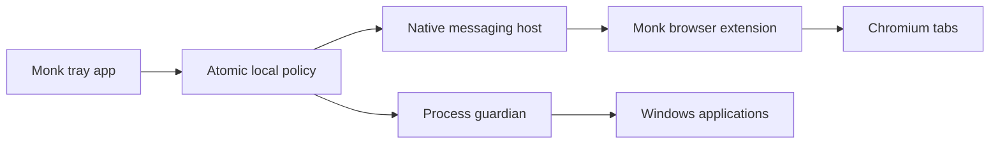

# Windows architecture

## Product parity

| Mac behavior | Windows implementation |
| --- | --- |
| Menu-bar app | Notification-area tray app |
| `Option+Space` panel | `Alt+Space` panel |
| App catalog from `.app` bundles | Installed-app registry plus running executables |
| Close apps outside the allowlist | Process watcher with graceful close, then termination |
| Inspect Safari/Chromium tabs | Chromium extension plus native messaging |
| Persist active commitment | Atomic JSON state in `%LOCALAPPDATA%\Monk` |
| Prevent Quit during focus/default block | Window/tray exit is refused while enforcement is active |
| CloudKit private sync | Deferred: Windows has no native private-CloudKit client |

The permanent safety allowlist contains the Windows shell, Start, Search,
Settings, security surfaces, and Monk itself. Browsers are added
only while a focus has one or more allowed domains; the extension then applies
the domain allowlist inside each tab.

## Trust boundaries

The browser extension reads only the effective enforcement policy. It never
receives the intention or application list and it makes no network requests.
The public extension key in the manifest is an identity pin, not a credential.

## Session state machine

1. `Idle`: no timed commitment. Optional default blocking may still run.
2. `Active`: policy is saved before enforcement begins.
3. `AwaitingDecision`: the timer reached zero, but enforcement stays active.
4. `Active`: the user extends from the current time; or `Idle`: the user ends.

There is no transition from `Active` to `Idle` before `EndsAt`. Closing the UI,
signing out, or restarting the app does not clear the saved policy.

## Production hardening plan

The desktop implementation is useful and testable without installing a
privileged component. Before public distribution, move process enforcement and
the authoritative clock into a signed, auto-start Windows service:

1. App sends a validated policy over an ACL-restricted named pipe.
2. Service persists policy under `%PROGRAMDATA%\Monk` with standard-user write
   access removed.
3. Service watches process starts through ETW/WMI and enforces even if the tray
   UI is killed.
4. Service accepts `extend` or `end` only when the monotonic deadline is met.
5. Installer upgrades and uninstall ask the service whether removal is allowed.
6. Code-sign the app, host, service, extension package, and installer; then
   test power loss, clock changes, safe mode, upgrades, and recovery.

This hardening deliberately remains a separate release gate: an unsigned
privileged service would add risk without providing trustworthy protection.
