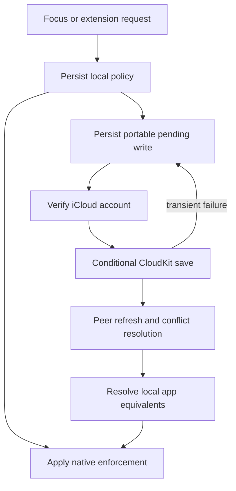

# Architecture

Monk is one Apple product with two application targets and native enforcement boundaries. The [1.0 product contract](PRODUCT_1.0.md) defines behavior; [ADR 0001](decisions/0001-apple-monorepo.md) explains why iPhone and iPad share a universal app while Mac remains a separate target.

## Components and dependencies

| Component | Owns | Does not own |
| --- | --- | --- |
| `Monk/` | Phone/tablet UI, Screen Time authorization, mobile service and local token mapping | Desktop process control or a public app catalog |
| `MonkMac/` | Menu bar/panel UI, local app catalog, app/browser guardians, Mac persistence | Mobile selection tokens |
| `Shared/` | Build configuration lookup, portable app/catalog identity, focus/default sync policy, durable portable outbox, parsers | Platform UI or raw token transfer |
| `HardBlockShieldExtension/` | Mobile blocked-app appearance | Cloud sync or session authority |
| `MonkDeviceActivityMonitor/` | Mobile interval callbacks and temporary-grant expiry | Ending a binding focus early |
| `MonkMacTests/` | Policy, parsing, identity, persistence and shared sync regressions | Proof of real Screen Time or notarized installation behavior |
| `Configurations/`, `script/`, `.github/`, `release/` | Version/configuration, repeatable build/export, CI/governance, readiness manifest | Runtime user data or production credentials |

The Xcode project explicitly controls shared-file membership. A file in `Shared/` is not automatically compiled by every target. Shared additions need both app builds; extensions include only the models/configuration needed for local enforcement. Keep local phone/tablet App Group models in `Monk/Shared/` when their consumers are the app and its extensions.

## Focus flow

The local policy becomes enforceable independently of upload success. Pending portable state is retried after reconnect/foreground/polling opportunities. CloudKit's current-focus singleton is coordinated state, not a transactional lock or session-history service. The shared resolver defines session conflict decisions; services must use the same rules before writing and when applying remote state. Details and exact fields are in the [data contract](DATA_CONTRACT.md).

## Mobile lifecycle

`CrossDeviceFocusService` coordinates authorization, saved selections, installed-app data when eligible, explicit local app mappings, Managed Settings shields, Device Activity scheduling, CloudKit notifications/refresh, and temporary grants. The app delegate registers for silent notifications and starts the service. Foreground refresh and polling complement notifications; iOS background delivery is opportunistic.

`FamilyActivitySelection` tokens stay local in the App Group. The active mobile state is written as an App Group JSON file for local continuity. Browser selections and local equivalents are device-specific. Optional non-tokenized installed-app access has stricter OS, regional, and authorization requirements than ordinary Screen Time access. The UI must continue to work with Apple's token picker when that enhancement is unavailable.

At focus expiry, the monitor deliberately leaves the focus shield in place; the app asks the person to extend or finish. Temporary-grant expiry is a separate callback path. A focus reaching zero does not itself authorize a background clear of enforcement.

## Mac lifecycle

`MonkMacEnvironment` composes long-lived services and connects sync/enforcement callbacks. `FocusSessionStore` persists the current focus and owns expiry decisions. `ApplicationGuardian` supervises local apps; `BrowserWebsiteGuardian` checks supported browser tabs. `ApplicationCatalog` discovers installed apps, and portable requests resolve to local descriptors. Paths remain local.

The Mac app is a menu-bar accessory with an `Option` + `Space` command panel. `LaunchAtLoginController` uses Service Management. A focus/default-blocking policy can refuse ordinary termination; development maintenance tooling must respect this behavior. Optional calendar recording is existing local functionality and is not a cloud integration requirement.

The full Mac build is unsandboxed and uses hardened runtime plus Apple Events. The intended distribution is Developer ID signing and notarization; the release export must retain iCloud provisioning support. The app is not being moved to the Mac App Store as part of 1.0.

## Privacy and account boundaries

Both app targets use the configured container's current-user private database. There is no Monk login or developer-operated backend. A durable outbox contains only portable intent and metadata. Account verification and account-change invalidation prevent treating a previously verified account as current forever; pending data must never be replayed into a different person's private database. Local enforcement and cloud upload authority are separate concerns.

CloudKit catalog records identify installations using random local UUIDs, not serial numbers or device names. Local Screen Time tokens, filesystem paths, grant details, and mapping selections must not enter cloud records, analytics, public issue attachments, or release artifacts.

## Deployment boundary

The source tree provides configuration and artifact tooling; Apple owns distribution capability approval, profiles/certificates, TestFlight/App Store review, notarization, and CloudKit schema environments. One compiled version is not evidence that those external resources are configured. The [release checklist](runbooks/RELEASE_CHECKLIST.md) records each gate explicitly.

Windows remains experimental and local-only with separate [architecture](../Windows/ARCHITECTURE.md). It is excluded from the Apple 1.0 shared-state promise.
