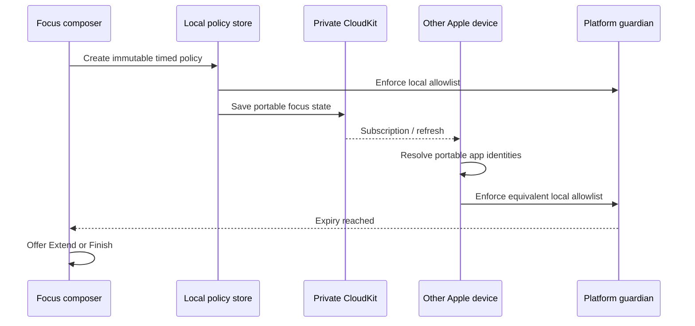

# Architecture

Monk is one product with platform-specific enforcement. The shared contract is intentionally small: an intention, a start and end date, an allowlist of domains, and portable descriptions of allowed applications.

## Design principles

1. **Allowlist, never denylist.** A session begins from no access and adds only what the task needs.
2. **The commitment is binding.** Active sessions cannot be ended early from the app.
3. **Private data stays private.** CloudKit uses the user's private database; local enforcement tokens never become cross-device identifiers.
4. **Native enforcement first.** Each platform uses the strongest appropriate system APIs rather than a shared abstraction that weakens them.
5. **Few moving parts.** No login, developer backend, analytics pipeline, subscription SDK, or general-purpose plugin system.

## Apple data flow

`CrossDeviceApplication` is the bridge between devices. It contains a stable portable identity and display metadata—not a Family Controls token. On iPhone and iPad, `FamilyActivitySelection` data remains in the App Group shared by the main app and its extensions. On Mac, the application catalog resolves an identity to a local bundle URL and bundle identifier.

## Mobile

The `Monk` target owns the SwiftUI experience and `CrossDeviceFocusService`. That service coordinates:

- Screen Time authorization through Family Controls;
- local app selections and always-allowed apps;
- Managed Settings shields;
- Device Activity expiry scheduling;
- private CloudKit reads, writes, and subscriptions;
- portable application catalogs for cross-device matching;
- temporary app grants requested through App Intents and Siri.

`HardBlockShieldUIExtension` supplies the minimal blocked-app appearance. `MonkDeviceActivityMonitor` reapplies the correct policy when a scheduled interval reaches its boundary. The extensions share only the data needed for enforcement through the configured App Group.

## macOS

The `MonkMac` target is a SwiftUI menu-bar application. `MonkMacEnvironment` composes its long-lived services:

- `FocusSessionStore` owns the current focus policy and persistence;
- `ApplicationGuardian` watches running apps and closes disallowed ones;
- `BrowserWebsiteGuardian` monitors supported browser tabs and redirects disallowed domains to Monk's local blocked page;
- `CrossDeviceFocusSyncService` exchanges portable policy state with private CloudKit;
- `CommandPanelController` and `GlobalHotKeyController` provide the `Option` + `Space` experience;
- `LaunchAtLoginController` manages the login item;
- `CalendarFocusRecorder` is an optional, local user-enabled record of completed focus time.

The Mac release intentionally is not sandboxed. Automation and application supervision are incompatible with the restrictions required for Mac App Store distribution, so production builds should be Developer ID signed and notarized for direct distribution.

## CloudKit records

CloudKit records are stored in the current user's **private** database. The implementation uses three logical record families:

- current focus commitment;
- default-access state;
- per-platform application catalogs used for human-readable matching.

The record constants live in `Shared/CrossDeviceApplication.swift`. The services tolerate missing optional fields so schema additions can remain backward-compatible. A development build can create development-schema fields; a release requires deploying that schema to CloudKit Production.

## Windows

The Windows implementation lives in its own solution and mirrors the policy semantics with a WPF tray app, process enforcement, a Chromium extension, and a native-messaging host. It is currently local-only because Windows cannot read an Apple user's private CloudKit database. Its threat model and hardening roadmap are documented in `Windows/ARCHITECTURE.md` and `Windows/ROADMAP.md`.

## Dependency boundaries

The Apple targets use system frameworks only. Shared files are deliberately limited to portable models, parsing, configuration, and small policy helpers. UI and enforcement remain in their owning platform directories so mobile privacy APIs do not leak into the Mac target and desktop automation does not leak into mobile.
